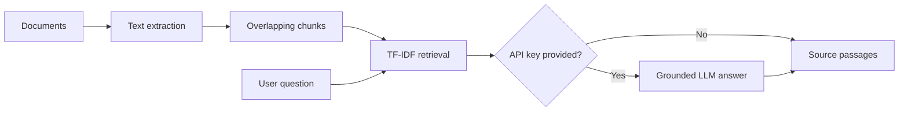

# KnowledgeForge AI — Document Intelligence & RAG

A portfolio-ready Streamlit app for source-grounded document search and optional LLM-assisted answers. Uses **synthetic demonstration documents** and supports PDF, DOCX, TXT and Markdown.

## Architecture



This is **retrieval-augmented generation when an LLM API key is supplied**. Without a key, it is a document retrieval demo. Retrieval uses TF-IDF, not embeddings or a vector database.

## Deploy on Streamlit Community Cloud

1. Extract the ZIP locally. Open the extracted `knowledgeforge-ai` directory.
2. Create a new GitHub repository, e.g. `knowledgeforge-ai`.
3. Upload the **contents of the folder**, preserving directories `knowledgeforge/`, `sample_docs/`, `tests/`, `.github/workflows/`, and `.streamlit/`. Do **not** flatten files.
4. Go to https://share.streamlit.io, choose **Create app**, and connect the repository.
5. Set branch `main` (or your actual default branch) and main file path `app.py`.
6. Click Deploy. The app works immediately with the bundled synthetic documents and **no API key**.
7. Optional: provide your own OpenAI API key in the app sidebar for grounded generated answers. API usage may incur costs.

**Security:** Do not upload patient data, confidential organizational files, passwords, or API keys. Public apps may expose uploaded content in an active session. For a real enterprise deployment, add authentication, document access controls, encrypted storage, audit logs, robust prompt-injection defenses, evaluation, and an approved data-handling policy.

## Run locally

```bash
python -m venv .venv
# Windows PowerShell: .venv\\Scripts\\Activate.ps1
# macOS/Linux: source .venv/bin/activate
pip install -r requirements.txt
streamlit run app.py
```

## Run tests

```bash
pip install pytest
python -m pytest -q
```

## Docker

```bash
docker build -t knowledgeforge-ai .
docker run --rm -p 8501:8501 knowledgeforge-ai
```

## Demo questions

- What is the escalation process for high-risk claims?
- Which metrics appear on the weekly operations dashboard?
- How are forecasting models evaluated?
- When should a challenger model replace a champion?

## Known limitations

- PDF extraction supports selectable text; scanned PDFs require OCR, which is not included.
- TF-IDF lexical retrieval may miss semantic matches and synonyms.
- LLM answers can be incorrect despite grounding; verify against cited passages.
- This is a portfolio prototype, not an enterprise compliance-ready service.
